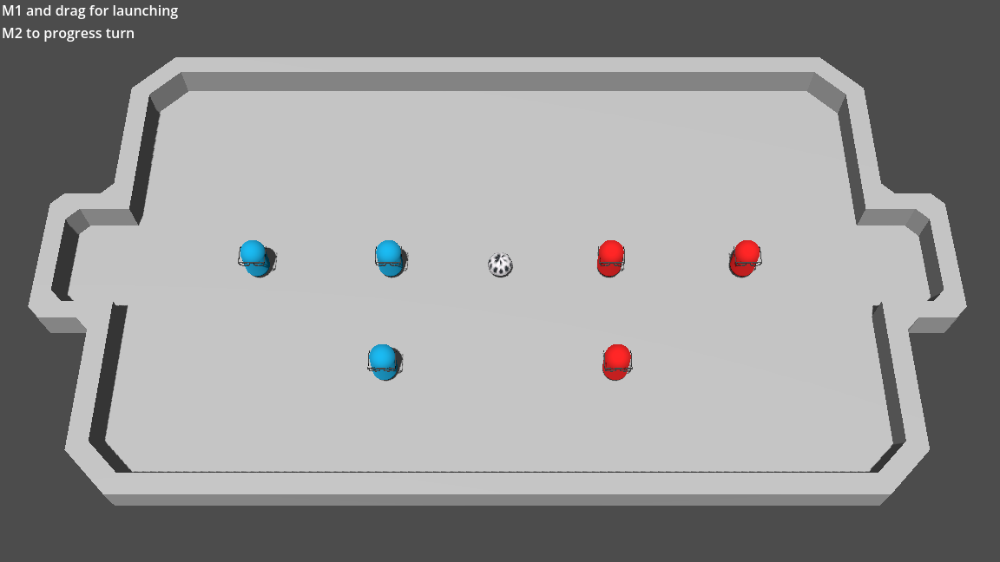
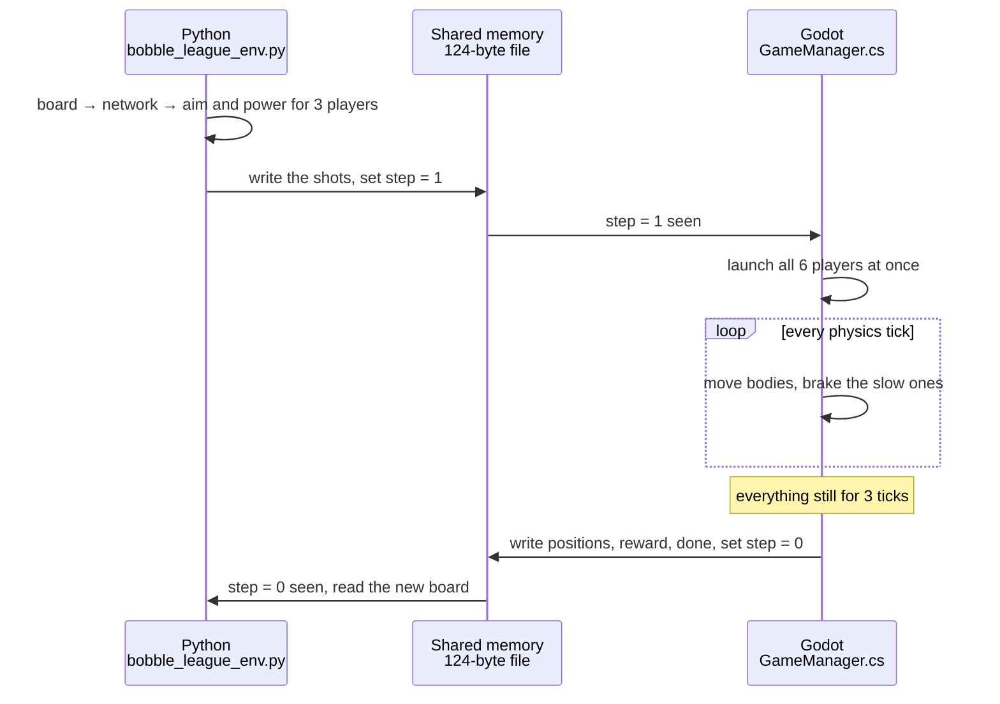
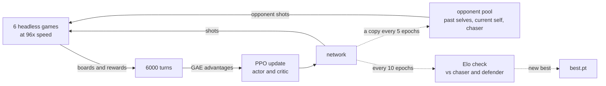

# Bobble League RL Agent

[](https://github.com/deaconsham/rl-bobble-league-agent/actions/workflows/ci.yml)

An AI that learns to play **Bobble League**, a 3v3 turn-based soccer game with
real physics b. The game runs in Godot 4 (C#). The AI is a small neural network
trained with PPO in PyTorch, by playing against itself. You can clone the repo and
play against it.



## Contents

- [Results](#results)
- [Play it](#play-it)
- [How it works](#how-it-works)
- [The math](#the-math)
- [For developers](#for-developers)
- [References](#references)

## Results

The shipped model is `bobble_model/Models/best_final.pt`. Over 40 games against
each test bot:

| Opponent | Win rate |
|---|---|
| random (random moves) | 95% |
| chaser (runs at the ball and shoots) | 68% |
| defender (guards its own goal) | 77% |
| replay (repeats one move that used to beat it) | 95% |

That puts it at about **1100 Elo**, where the chaser is pinned at 1000.

## Play it

### 1. Install

- [Godot 4.6.1, .NET build](https://godotengine.org/download) (the plain build can't run C#)
- [.NET 8 SDK](https://dotnet.microsoft.com/download)
- Python 3.12+

```
git clone <this repo>
cd RL-Bobble-League-Agent
pip install -r bobble_model/requirements.txt
```

Any PyTorch build works. The network is tiny, so a CPU is plenty.

### 2. Play

```
python bobble_model/Scripts/play.py --godot "C:\path\to\Godot_v4.6.1-stable_mono_win64.exe"
```

Or set the `BOBBLE_GODOT_EXE` environment variable once and drop `--godot`. The
first run builds the C# and imports the assets (a minute or two), then the game
window opens.

### 3. Controls

You are **blue**, attacking the goal on the right.

| Input | What it does |
|---|---|
| left-drag a blue player | aim. The arrow shows the shot; a longer drag is a harder shot |
| right-click | end your turn |

You can aim all three players, then right-click. The AI picks its three shots at
the same time, then everything launches together and plays out. First goal wins
the round, then it's back to kickoff. Close the window to quit.

### Other ways to play

- **From the Godot editor:** open `bobble_league/` in Godot, press Play (the scene
  starts in human vs AI mode), then run `python bobble_model/Scripts/evaluate.py --human`.
- **Two people, no AI:** in the editor, set `GameManager > CurrentPlayMode` to
  `HUMAN_VS_HUMAN`. Blue aims and right-clicks, then red aims and right-clicks.
- **Watch the AI play a bot:** start the game with `--mode=ai_vs_ai` (see
  [Godot command line](#godot-command-line)), then
  `python bobble_model/Scripts/evaluate.py --opponent chaser --episodes 20`.

## How it works

The game (Godot, C#) and the AI (Python) are separate programs. They take turns
through a small shared file. One turn looks like this:



### The game

Each turn both teams choose an aim and a power for all three players at once.
Godot launches everyone, then runs the physics (Jolt) until the ball and every
player have stopped. Only then does it send the new positions to Python and wait
for the next turn. A goal ends the round and resets to kickoff.

A player launched at full power moves at 15 m/s. A player that hits the ball
faster than 5 m/s kicks it with an extra impulse. Linear damping slows everything
down (0.3 on the ball, 0.6 on players). Below 1 m/s a steady brake brings each
body to a clean stop, so a turn ends once things have really come to rest (see
[the brake](#the-brake)).

### The bridge

The game and Python share a 124-byte memory-mapped file. Python writes the
actions and sets a "step" byte. Godot sees it, plays the turn, writes the
observation, reward and done flag, then clears the byte. A version byte (now v5)
stops a mismatched build from sending garbage. The full byte layout is at the top
of `SharedMemory.cs` and `shared_memory_link.py`.

Because it's just a file, one Python process can drive many headless games at
once: training runs 6 games at 96x speed and steps each one as soon as it's
ready.

### What the AI sees and does

It sees **14 numbers**: the ball's position and the six players' positions (own
team first). Each team sees the board mirrored so that it always attacks the
same way, which lets one network play either side.

It outputs **6 numbers**, an angle and a power for each of its three players.

### How it learns

The network has two heads: an **actor** that picks the shots and a **critic** that
guesses how good the current board is. PPO plays a batch of turns, compares what
happened with what the critic expected, and nudges the actor toward the shots
that did better than expected. Each update is kept small so learning stays stable.



The training loop follows [OpenAI Spinning Up's PPO](https://spinningup.openai.com/en/latest/algorithms/ppo.html)
(the same KL early stop, learning rates and $\lambda$), extended to run several
games at once and to play against other teams.

Goals are rare, so the reward also gives small hints each turn: move the ball
toward the enemy goal, keep players near the ball, and keep someone between the
ball and your own goal. The hints fade out over the first half of training, so in
the end it plays for goals.

### Who it plays against

It practises against a pool of opponents so it doesn't overfit to one style:
mostly past copies of itself, often its current self (and then both teams' turns
are used as training data), and sometimes the scripted chaser.

### Picking the best model

Every 10 epochs the current model plays the chaser and defender bots, and its
Elo rating is worked out from the results. The best one is saved as `best.pt`.
Elo only picks the champion; it isn't the reward. Elo comes once per game and
depends on the opponent, while PPO needs feedback on every move.

## The math

New to RL? OpenAI Spinning Up's three-part intro covers every idea used here:
[Key Concepts](https://spinningup.openai.com/en/latest/spinningup/rl_intro.html)
(policies, returns, value and advantage functions),
[Kinds of RL Algorithms](https://spinningup.openai.com/en/latest/spinningup/rl_intro2.html)
and [Intro to Policy Optimization](https://spinningup.openai.com/en/latest/spinningup/rl_intro3.html).

### Observation

Let $(x, z)$ be a position on the pitch, with half-sizes $H_x = 10$ and
$H_z = 18.5$. Team B's view is mirrored, $z \to -z$, so every team attacks $-z$.
The network gets each coordinate scaled to $[-1, 1]$:

$$
o = \text{clip}\left(\left[\tfrac{x_\text{ball}}{H_x}, \tfrac{z_\text{ball}}{H_z}, \tfrac{x_1}{H_x}, \tfrac{z_1}{H_z}, \dots, \tfrac{x_6}{H_x}, \tfrac{z_6}{H_z}\right], -1, 1\right) \in \mathbb{R}^{14}
$$

### Action

The actor outputs the mean $\mu_\theta(o) \in \mathbb{R}^6$ of a
[diagonal Gaussian policy](https://spinningup.openai.com/en/latest/spinningup/rl_intro.html#stochastic-policies),
with a learned standard deviation that doesn't depend on the board. During
training, actions are sampled; in play, the mean is used.

$$ 
a \sim \mathcal{N}\left(\mu_\theta(o), \mathrm{diag}(\sigma^2)\right), \qquad \sigma = e^{\log\sigma}, \quad \log\sigma_0 = -1.6 \ (\sigma_0 \approx 0.2) 
$$


Each player $i$ gets an angle number $a_i$ and a power number $p_i$. The angle wraps
around (it's a circle) and the power is clipped:

$$
a_i \leftarrow \left((a_i + 1) \bmod 2\right) - 1, \qquad \phi_i = \pi a_i, \qquad \hat{d}_i = (\sin\phi_i, -\cos\phi_i)
$$

$$
s_i = 0.2 + 0.8 \cdot \frac{\text{clip}(p_i, -1, 1) + 1}{2}, \qquad v_i = 15 \, s_i \, \hat{d}_i \ \text{m/s}
$$

So $a_i = 0$ shoots straight at the enemy goal, $a_i = \pm 1$ straight back at your
own, and power runs from 20% to 100%.

### Network

Two separate MLPs, each with two hidden layers of 256 tanh units (plus LayerNorm
in the shipped model) and orthogonal initialization:

$$
\mu_\theta : \mathbb{R}^{14} \to \mathbb{R}^6, \qquad V_\psi : \mathbb{R}^{14} \to \mathbb{R}
$$

### Reward

The goal reward is $g \in \{+1, -1, 0\}$ (scored, conceded, neither). On top of it,
a shaping term rewards progress between the board before a turn, $s$, and after
it, $s'$. With $b$ the ball, $f_j$ your players, $G$ the enemy goal and $d$ the
distance:

$$
r = g + w_b \frac{d(b, G) - d(b', G)}{H_z} + w_p \frac{1}{3}\sum_{j=1}^{3} \frac{d(f_j, b) - d(f'_j, b')}{H_z} - w_d \, \mathbb{1}[\text{no player goal-side of the ball}]
$$

with $w_b = 0.5$, $w_p = 0.05$, $w_d = 0.02$. With `--shaping-fade` the weights
are scaled down linearly to 0 by the halfway epoch.

`--potential-shaping` switches to the exact potential-based form
$F = \gamma\Phi(s') - \Phi(s)$, $\Phi = 0$ at a goal, which provably keeps the best
policy unchanged (Ng et al. 1999). It's off by default because it didn't beat the
simpler form in testing.

### Advantages (GAE)

The [advantage](https://spinningup.openai.com/en/latest/spinningup/rl_intro.html#advantage-functions)
says how much better a turn went than the critic expected. Using it instead of
the raw return is the [baseline](https://spinningup.openai.com/en/latest/spinningup/rl_intro3.html#baselines-in-policy-gradients)
trick, which cuts the noise in the policy gradient. With $\gamma = 0.99$ and $\lambda = 0.97$:

$$
\delta_t = r_t + \gamma V_\psi(s_{t+1}) - V_\psi(s_t), \qquad \hat{A}_t = \sum_{l \ge 0} (\gamma\lambda)^l \, \delta_{t+l}
$$

The critic's target is the discounted return $\hat{R}_t = \sum_{l \ge 0} \gamma^l r_{t+l}$.
Advantages are normalized per batch: $\hat{A} \leftarrow (\hat{A} - \text{mean}) / \text{std}$.

### PPO update

The probability ratio between the new and old policy, and the clipped objective
the actor maximizes (see Spinning Up's [PPO key equations](https://spinningup.openai.com/en/latest/algorithms/ppo.html#key-equations)):

$$
\rho_t(\theta) = \frac{\pi_\theta(a_t \mid s_t)}{\pi_{\theta_\text{old}}(a_t \mid s_t)}, \qquad
L^\text{clip}(\theta) = \mathbb{E}_t\left[\min\left(\rho_t \hat{A}_t, \ \text{clip}(\rho_t, 1 - \epsilon, 1 + \epsilon) \hat{A}_t\right)\right]
$$

The clip means a shot can't be made more than $1 \pm \epsilon$ times as likely in
one update. The critic minimizes a squared error on value targets normalized by a
running mean $m$ and standard deviation $s$ of the returns:

$$
L^V(\psi) = \mathbb{E}_t\left[\left(V_\psi(s_t) - \frac{\hat{R}_t - m}{s}\right)^2\right]
$$

Settings for the shipped model: $\epsilon = 0.15$, 5 actor passes and 15 critic
passes per batch in 4 minibatches, Adam (actor lr $3 \cdot 10^{-4}$, critic lr
$10^{-3}$, weight decay $10^{-4}$), gradient norm clipped to 0.5. The actor stops
early in a batch once its approximate KL divergence passes $1.5 \times 0.02$
(Spinning Up's rule). The
learning rate falls linearly over the run but never below 30% of where it started:

$$
\eta_k = \eta_0 \max\left(0.3, \ 1 - \frac{k}{K}\right)
$$

### Elo

The expected score of A against B, and the update after a game with score
$S \in \{1, \tfrac{1}{2}, 0\}$:

$$
E_A = \frac{1}{1 + 10^{(R_B - R_A)/400}}, \qquad R_A \leftarrow R_A + 32\,(S - E_A)
$$

The bots are pinned (chaser 1000, defender 950, replay 850, random 800) so the
scale never drifts. A new model replaces `best.pt` only if its Elo beats the
current best by more than 25 (about the noise in a 20-game check) and it doesn't
clearly lose to it head to head.

### The brake

Each physics tick ($\Delta t = 1/60$ s), linear damping $c$ applies, and below
$v_b = 1$ m/s a constant deceleration $a_b = 3$ m/s² takes over until the body stops:

$$
v \leftarrow v(1 - c\,\Delta t), \qquad
v \leftarrow \begin{cases} v & v \ge v_b \\ \max(0, \ v - a_b \Delta t) & v < v_b \end{cases}
$$

Damping alone never quite reaches 0, because speed only shrinks by a fraction
each tick. The brake stops a body in at most $v_b / a_b \approx 0.33$ s, after
rolling at most $v_b^2 / 2a_b \approx 0.17$ units.

## For developers

### Project layout

```
bobble_league/              the Godot game (C#)
  Scripts/
    GameManager.cs          turns, goals, resets, the AI turn loop
    Ball.cs, Player.cs      bodies, kicks and the brake
    DataManager.cs          builds the observation
    SharedMemory.cs         the bridge (Godot side)
    SettleCheck.cs          optional --settle-check diagnostic
    TeamGoal.cs             goal triggers
  Scenes/                   scene.tscn (the match), arena, player
  Models/, Texture/         3D models and textures
bobble_model/               the AI (Python)
  Scripts/
    play.py                 play against the AI
    training_loop.py        PPO trainer and its command line
    bobble_league_env.py    environment, vector env, reward shaping
    neural_network.py       actor-critic network and running normalizers
    shared_memory_link.py   the bridge (Python side)
    opponents.py            scripted bots and the self-play pool
    live_elo.py             Elo checks during training
    league_eval.py          Elo league between saved models
    evaluate.py             watch or play against a model
    launch_games.py         starts headless games
    warm_start.py           copies the chaser into a fresh network
    elo.py                  Elo maths
  Models/                   saved models (only the two shipped ones are in git)
  requirements.txt
tests/
  unit/                     no Godot needed
  mock/                     against a fake Godot (tests/mock_godot.py)
  live/                     against the real game
scripts/smoke_test.ps1      build, import, short training run and eval
.github/workflows/ci.yml    tests and C# build on every push
```

Training writes `Models/` (saves), `logs/` (game logs) and `runs/` (TensorBoard)
under `bobble_model/`. All three are gitignored apart from the two shipped models.

### Train

Run training from `bobble_model/`. This is the recipe that made the shipped
model. It fine-tunes from `best_p11_ln.pt` over 6 headless games and plays live
Elo checks on a 7th:

```
cd bobble_model
python Scripts/training_loop.py --games 6 --launch --epochs 200 --steps-per-epoch 6000 \
    --opponent self --init-checkpoint Models/best_p11_ln.pt \
    --use-layernorm --weight-decay 1e-4 --value-norm \
    --n-passes 5 --n-passes-v 15 --clip-ratio 0.15 --n-minibatches 4 --shaping-fade \
    --live-elo-shm runs/live_elo.dat --best-path my_run/best.pt --checkpoint-dir my_run
```

- Each game needs about 170 MB of RAM. Use `--games 4` if you're short.
- About 5800 turns a minute on a 12-core machine. The network is small, so a GPU
  barely helps; Godot's physics is the bottleneck.
- Resume a crashed run with `--resume my_run/ppo_epoch_<N>.pt`.
- To start from scratch, build a warm start first: `python Scripts/warm_start.py --games 6`.
- All flags: `python Scripts/training_loop.py -h`.

Watch it learn with `tensorboard --logdir runs`. The numbers worth watching:

| Metric | Healthy |
|---|---|
| `Training/KL_Divergence` | mostly under 0.02 |
| `Training/Clip_Fraction` | about 0.1 to 0.3 |
| `Training/Explained_Variance` | above 0 and rising |
| `Training/Entropy` | falls slowly. A sudden drop means the aim spread collapsed |
| `Elo/Live_Mean` | rising |

### Evaluate

```
python Scripts/evaluate.py --opponent chaser --episodes 20
python Scripts/league_eval.py --checkpoints Models/best_final.pt my_run/best.pt --games 40 --shm <game shm>
```

`evaluate.py` needs one running game. `league_eval.py` plays every model against
every other model and the bots, and prints an Elo table. Pass several games'
shm files with `--shms` to spread the matches out. Start games with
`python Scripts/launch_games.py --games 4`.

### Godot command line

Arguments after `--` go to the game:

```
godot --path bobble_league --headless -- --mode=ai_vs_ai --timescale=96 --shm=C:\tmp\game0.dat
```

| Flag | Meaning |
|---|---|
| `--mode=` | `ai_vs_ai`, `human_vs_ai` or `human_vs_human` |
| `--timescale=N` | speed up AI games. Physics ticks scale with it, so each step stays 1/60 s |
| `--shm=PATH` | the shared memory file (default: the temp folder) |
| `--brake-speed=N`, `--brake-decel=N` | the brake (defaults 1.0 m/s and 3.0 m/s²) |
| `--settle-check` | print one `SETTLE` line per turn: stop speeds and any movement after the positions were sent |

### Changing things

- **Rewards** live in Python (`RewardConfig` in `bobble_league_env.py`), so tuning
  them doesn't need a game rebuild.
- **Game code:** after editing C#, run `dotnet build bobble_league/BobbleLeague.csproj`.
  Physics changes (damping, brake, kick) change the game the model learned, so
  re-check its strength with `league_eval.py` and fine-tune if it drops.
- **The bridge:** change the layout on both sides (`SharedMemory.cs` and
  `shared_memory_link.py`) and bump `PROTOCOL_VERSION` in both.
- **The action or observation meaning:** bump `ACTION_FORMAT_VERSION` in
  `training_loop.py` so old saves are refused instead of playing garbage.
- **Network shape** (layers, LayerNorm): old saves won't load into it, so train or
  warm start a new one.

### Tests

| What | Command | Needs Godot |
|---|---|---|
| unit + mock | `python -m pytest -m "not live"` | no |
| live settle check | `python -m pytest -m live tests/live` | yes |
| smoke test | `powershell -File scripts/smoke_test.ps1` | yes |

Unit and mock tests are seeded so they repeat exactly. Godot physics isn't fully
repeatable, so the live tests check ranges. Set `BOBBLE_GODOT_EXE` for the live ones.

GitHub Actions ([ci.yml](.github/workflows/ci.yml)) runs the unit and mock tests on
Python 3.12 and 3.14, and builds the C#, on every push and pull request. The live
tests and the smoke test need a real Godot, so run them yourself before merging
physics or bridge changes.

## References

- Achiam. *Spinning Up in Deep Reinforcement Learning* (OpenAI, 2018). [spinningup.openai.com](https://spinningup.openai.com/)
- Schulman et al. *Proximal Policy Optimization Algorithms* (2017). [arxiv.org/abs/1707.06347](https://arxiv.org/abs/1707.06347)
- Schulman et al. *High-Dimensional Continuous Control Using Generalized Advantage Estimation* (2015). [arxiv.org/abs/1506.02438](https://arxiv.org/abs/1506.02438)
- Ng, Harada, Russell. *Policy Invariance Under Reward Transformations* (1999). [PDF](https://people.eecs.berkeley.edu/~pabbeel/cs287-fa09/readings/NgHaradaRussell-shaping-ICML1999.pdf)
- Andrychowicz et al. *What Matters in On-Policy Reinforcement Learning?* (2020). [arxiv.org/abs/2006.05990](https://arxiv.org/abs/2006.05990)
- Huang et al. *The 37 Implementation Details of PPO* (2022). [iclr-blog-track.github.io](https://iclr-blog-track.github.io/2022/03/25/ppo-implementation-details/)
- Yu et al. *The Surprising Effectiveness of PPO in Cooperative Multi-Agent Games* (2021). [arxiv.org/abs/2103.01955](https://arxiv.org/abs/2103.01955)
- Cobbe et al. *Phasic Policy Gradient* (2020). [arxiv.org/abs/2009.04416](https://arxiv.org/abs/2009.04416)
- Schmitt et al. *Kickstarting Deep Reinforcement Learning* (2018). [arxiv.org/abs/1803.03835](https://arxiv.org/abs/1803.03835)
